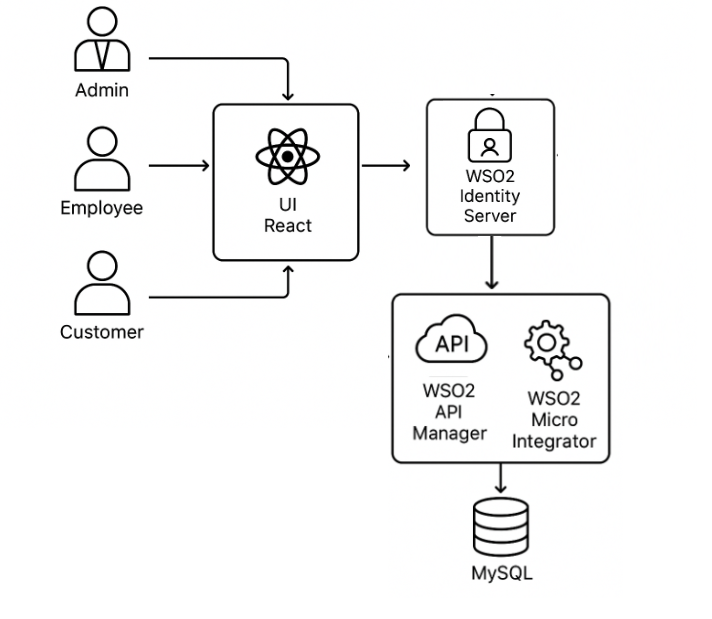

# Insurance Demo - Documentation

## Project Overview

This is a modern insurance management project built using WSO2 Micro Integrator and WSO2 API Manager. The UI is developed with React, TypeScript, and Vite. It supports multiple user roles (Admin, Employee, Customer) and provides a real-time, interactive interface for managing insurance policies, claims, customers, and employees.



## System Requirements

- Node.js (v18+)
- npm - 10.9.2 or any
- JDK 21
- MySQL Server
- Docker (Rancher Desktop - (1.19.3) / Colima or any)


## Required Tools

- WSO2 Micro Integrator - 4.4.0
- WSO2 API Manager - 4.5.0
- WSO2 identity Server - 7.1.0
- MySQL Workbench - 8.0
- Postman or cURL
- Visual Studio Code or any IDE

## Customer Portal — Functionalities

The Customer portal empowers users to manage their own insurance needs. A customer user can:

**Manage claims:**  
Customers can view a list of all their claims, file new claims easily using a guided form, and track the status and history of each claim as it is processed.

**Stay on top of policies:**  
Customers can browse all their insurance policies, see the details of each, and understand their coverage.

**Keep information up to date:**  
Customers can view and edit their personal profile, ensuring contact and address information is always current.

## Employee Portal — Functionalities

The Employee portal is designed for staff who manage customers and process claims. An employee user can:

**See workload at a glance:**  
The dashboard shows assigned claims, customers, and policies, helping employees prioritize their work.

**Process claims efficiently:**  
Employees can view all claims assigned to them, open each claim to see details, update statuses, and add notes throughout the claim process.

**Support customers:**  
Employees can see a list of customers assigned to them, view customer profiles, and understand their policies and claim history. This enables better service and informed responses to customer inquiries.

**Stay informed about products and policies:**  
Employees can browse available insurance products and policies relevant to their customers, making it easier to provide recommendations and stay updated.

**Manage their own profile:**  
Employees can view and update their own profile information to keep contact details current.

## Admin Portal — Functionalities

The Admin portal provides full control over the insurance platform. An admin user can:

**Monitor the business:**  
The dashboard displays real-time metrics about claims, policies, and users, allowing quick assessment of the platform's health.

**Manage claims:**  
Admins can access claim details, approve or reject (change the current status) claims, and assign them to employees for processing.

**Oversee customers:**  
Admins can browse a list of all customers, view their details, and see associated policies and claims. They can add new customers, their information, or remove them if needed.

**Oversee employees:**  
Admins can view all employees, add new ones, update their details, and remove them if necessary.

**Manage policies and products:**  
Admins can create, edit, and delete insurance policies and products. They can assign policies to customers and analyze which products are most popular.

---

## Backend Overview

The backend for this project is a RESTful Data service from Micro Integrator that powers all business logic and data storage for the Insurance Demo platform. It is responsible for securely handling requests from the frontend, managing customers, policies, claims, and more.

### Key Technologies & Architecture:

- Built with RESTful DataService through WSO2 MI and API Manager
- Data stored in a relational database (MySQL)
- CORS enabled for frontend-backend communication through WSO2 APIM

### Integration with Frontend:

- The frontend communicates with the backend exclusively via HTTPS REST API calls
- All business operations (CRUD for claims, policies, users, etc.) are performed through these endpoints
- Email notifications and address validation are triggered by backend endpoints which are through WSO2 Micro Integrator.

## Quick Start

## Prerequisites

I used Rancher Desktop (1.19.3). You can use any.

But ensure Docker is running on your machine before proceeding.

## Deployment Steps

### 1. Clone the Repository and Navigate to Docker Deployment Directory

Open a terminal or command prompt and run:

```bash
git clone <your-repo-url>
cd docker-deployment
```

Replace 'your-repo-url' with the Git repository URL of the InsuranceDemoV2 branch.

### 2. Build the Docker Image

Run the following command from the `docker-deployment` directory to build the Docker image:

```bash
docker build -t insurance-img .
```

### 3. Run the Docker Container

Once the image is built, start the container using:

```bash
docker run -it --rm -p 9090:9090 -p 9091:9091 -p 9092:9092 -p 9093:9093 -p 9094:9094 -p 9095:9095 -p 9096:9096 -p 8090:8090 -p 8253:8253 -p 8254:8254 -p 8290:8290 -p 9164:9164 -p 3307:3306 -p 9446:9446 -p 8246:8246 -p 8283:8283 -p 1025:1025 -p 8025:8025 -p 5173:5173 -p 9443:9443 -p 9763:9763 -p 10301:10301 insurance-img
```

**Note: Port Offset Configuration**

A port offset of 3 has been applied to avoid conflicts. WSO2 API Manager will be accessible on port 9446 instead of the default 9443.

## Deployment in WSO2 Identity Server

### 1. Login to the Identity Server Console
1. Open the console in your browser at:  
   **https://localhost:9443/console**  
2. Login using the admin credentials:  
   - **Username:** `admin`  
   - **Password:** `admin`  

---

### 2. Create an Application
1. Navigate to **Applications** → **New Application**.  
2. Under **Application Types**, select **Single-page Application**.  
3. Enter the following details:  
   - **Name:** *(Enter your preferred application name)*  
   - **Authorized Redirect URLs:**  
     ```
     http://localhost:5173/
     ```
     *(Port may vary depending on your Vite app)*  
4. Click **Create**.  

---

### 3. Create an Attribute
1. Navigate to **User Attributes & Stores** → **Attributes**.  
2. Under **Manage Attributes**, click **New Attribute**.  
3. Fill in the details:  
   - **Attribute Name:** `db_id`  
   - **Attribute Display Name:** `db_id`  
4. Click **Finish**.  

---

### 4. Create an OIDC Scope for the Attribute
1. Go to **User Attributes & Stores** → **Attributes**.  
2. Under **Manage Attribute Mappings**, select **OpenID Connect**.  
3. Click **Scopes** (right side of the search bar).  
4. Click **New OIDC Scope** and enter:  
   - **Scope:** `db_id`  
   - **Display Name:** `db_id`  
5. Click **Next**.  
6. In the attribute list, select the previously created `db_id` attribute.  
7. Click **Finish**.  

---

### 5. Add the Scope to the Application
1. Navigate to **Applications** and select the created application.  
2. Go to the **User Attributes** tab.  
3. Tick the checkboxes for:  
   - `db_id`  
   - `groups`  
4. Scroll down and click **Update**.  

---

### 6. Create a User Store
1. Navigate to **User Attributes & Stores** → **User Stores**.  
2. Click **New User Store** and select **Database** as the **User Store Type**.  
3. Enter the following details:  
   - **Name:** `insurance`  
   - **Connection URL:**  
     ```
     jdbc:mysql://localhost:3306/insurance
     ```
   - **Connection Name:** `root`  
   - **Connection Password:** `root_password`  
   - **Driver Name:** `com.mysql.cj.jdbc.Driver`  

---

### 7. Create Groups
1. Navigate to **User Management** → **Groups**.  
2. Select the **insurance** user store from the top-right dropdown (instead of `PRIMARY`).  
3. Click **Add Group**.  
4. Create the following groups (click **Finish** after each one):  
   - `Customer`  
   - `Employee`  
   - `admin`  

---

### 8. Create Users
> **Note:** Since this is an insurance domain portal, self-registration is **not** allowed. All users must be created manually with passwords.

1. Navigate to **User Management** → **Users**.  
2. Select the **insurance** user store from the top-right dropdown (instead of `PRIMARY`).  
3. Click **Add User** → **Single User**.  
4. Fill in the details:  
   - **Username:** *(use email format)*  
   - **db_id:** *(as per database records)*  
   - **Password:** *(set manually)*  
5. Click **Next** and assign the user to one of the groups:  
   - `Customer`  
   - `Employee`  
   - `admin`  
6. Click **Save and Continue**.  

---

### 9. User Data from Database

### Employees
| Name       | db_id  |
|------------|--------|
| Alice      | E_001  |
| Bob        | E_002  |
| Carol      | E_003  |
| Divya      | E_004  |
| Eve_emp    | E_005  |

### Customers
| Name   | db_id  |
|--------|--------|
| David  | C_001  |
| Divya  | C_002  |
| Frank  | C_003  |
| Grace  | C_004  |
| Harry  | C_005  |

---

**You have now completed the WSO2 Identity Server configuration for your project.**


## API Configuration

### Import and Deploy Swagger Files via Publisher Portal

#### 1. Access the Publisher Portal

- Open your web browser and go to: https://localhost:9446/publisher
- Log in with your Publisher credentials:
  - **Username: admin**
  - **Password: admin**

#### 2. Navigate to the API Import Section

- On the dashboard, click "REST API"
- Select "Import OpenAPI" to begin importing Swagger files

#### 3. Locate Swagger Files

- Browse to the `docker-deployment\Api-definitions` folder
- This folder contains 7 Swagger files that define the APIs

#### 4. Import Each Swagger File

For each of the 7 Swagger files:

- Click "Browse File" or drag & drop the file
- Fill in any additional required fields (e.g., version, context, endpoint, etc.)
- Click "Create" to finish the import

#### 5. Configure JSON Responses

After importing each API:

- Click on the "policies" tab within each API
- Select XML to JSON mediator under Policy List -> Request -> Common policies
- Drag and drop on response flow
- Select and Apply to all resources option and save it
- At the bottom of the page, click "save and deploy"
- Select default gateway and deploy it
- Repeat this process for all 7 APIs

## Testing the Application

### UI Access

Open your browser and go to: http://localhost:5173

### Postman Testing

Use the endpoints provided in the `docker-deployment\PostmanCollection` to interact with the backend services.

## Portal Access and Credentials

Once the frontend is running, open your browser and navigate to:  
**http://localhost:5173/**  

You will see a login screen with access to three portals.  

For each user created in the Identity Server, you have a **username** and **password**. Using these credentials, you can log in and navigate to the corresponding role-specific UI, which will display the relevant details for that user.  

Use the appropriate credentials to access each portal based on the user’s role.

## Recordings
[https://drive.google.com/file/d/15KLD_Vo8wBeePMmoSGeIeXyJNuNbAov1/view?usp=drive_link](https://drive.google.com/file/d/15KLD_Vo8wBeePMmoSGeIeXyJNuNbAov1/view?usp=drive_link)
